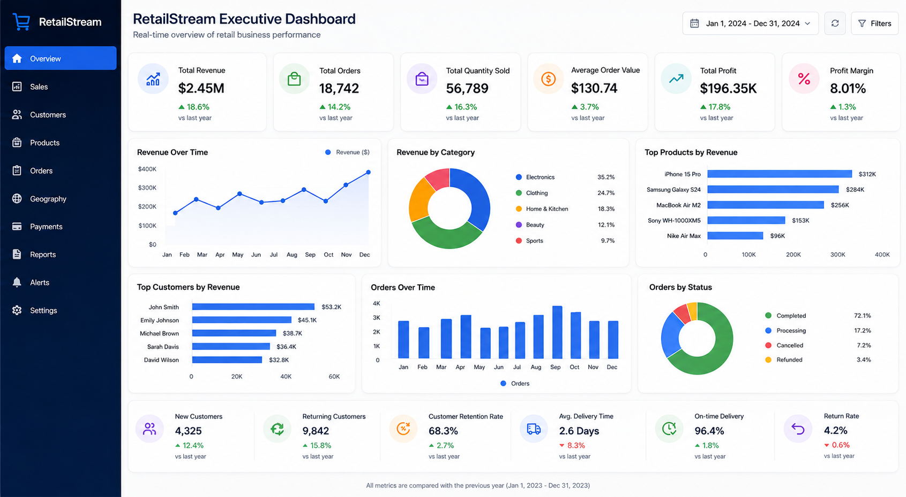
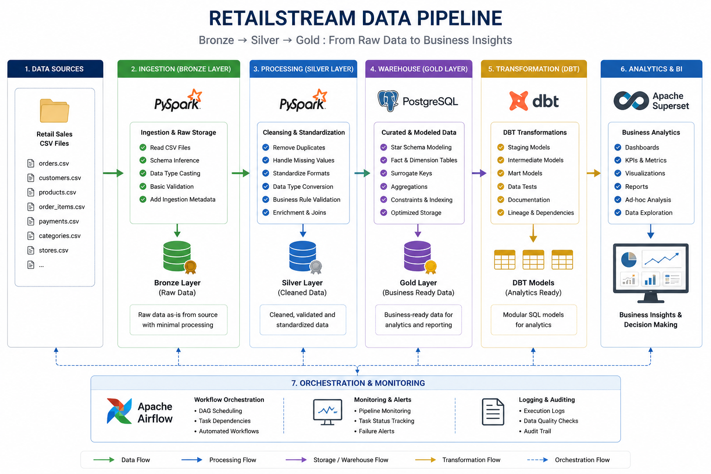
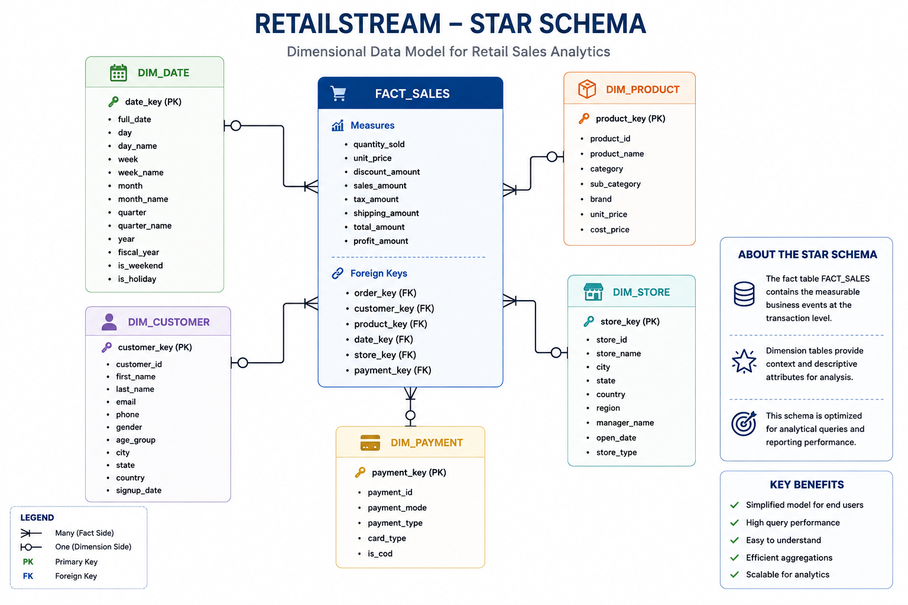
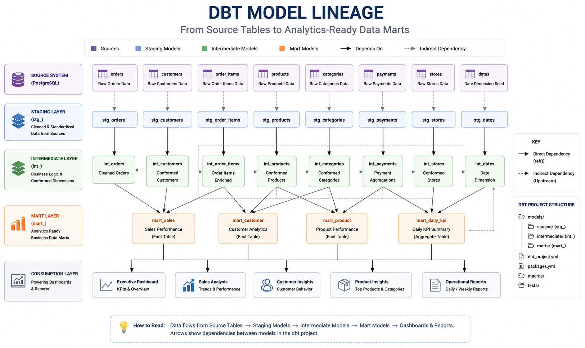
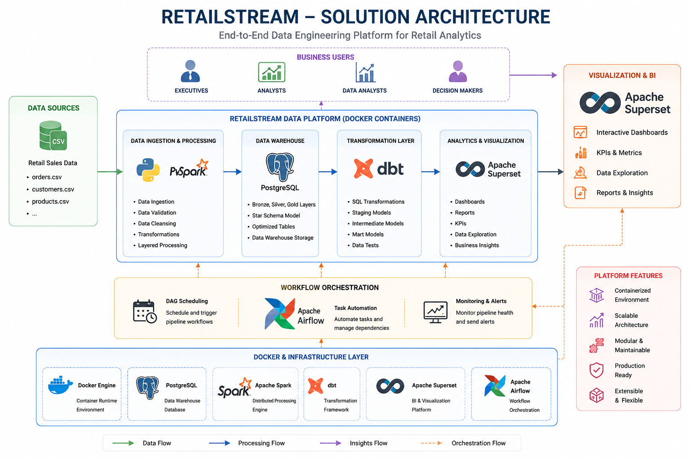

# 🚀 RetailStream Data Platform

> **A modern end-to-end Data Engineering platform that transforms raw retail sales data into business-ready insights using PySpark, PostgreSQL, dbt, Apache Superset, Docker, and Apache Airflow.**

<p align="center">


</p>

---

> **From raw CSV files to interactive business dashboards — a complete modern Data Engineering pipeline.**

## 📊 Executive Dashboard

The RetailStream Executive Dashboard provides a comprehensive view of business performance through interactive visualizations built with **Apache Superset**.

### Dashboard Highlights

- 💰 Total Revenue
- 📦 Total Orders
- 🛒 Total Quantity Sold
- 💳 Average Order Value
- 🧾 Total Tax Collected
- 📈 Monthly Revenue Trend
- 📊 Revenue by Product Category
- 🏆 Top Performing Products
- 👥 Top Customers by Revenue

<p align="center">



</p>

> **Note:** Replace `images/dashboard.png` with the screenshot of your completed dashboard.

## 📖 Project Overview

Retail organizations generate thousands of sales transactions every day. Transforming this raw operational data into meaningful business insights requires a scalable and reliable data engineering pipeline capable of ingestion, transformation, storage, and visualization.

RetailStream demonstrates how a modern data platform can be built using industry-standard tools and best practices. The project ingests raw retail datasets, processes them using **PySpark**, stores curated data in a **PostgreSQL** data warehouse, transforms the data into analytics-ready models using **dbt**, and presents interactive business dashboards through **Apache Superset**.

The platform follows a layered data architecture (**Bronze → Silver → Gold**) and implements dimensional modeling using a **Star Schema** to support analytical workloads. Every component is containerized using **Docker**, enabling a reproducible development environment, while **Apache Airflow** orchestrates the complete data pipeline.

This project is designed to simulate a production-grade analytics platform and demonstrate the complete lifecycle of modern data engineering—from raw data ingestion to business intelligence reporting.

## 🎯 Business Problem

Retail companies generate large volumes of transactional data every day.

Without a centralized analytics platform, business users struggle to answer questions like:

- Which products generate the highest revenue?
- Who are the most valuable customers?
- How are monthly sales trending?
- Which product categories perform best?

RetailStream solves this by building an end-to-end analytics platform that converts raw transactional data into interactive business dashboards.

## ⭐ Key Features

RetailStream implements a complete modern data engineering workflow by combining scalable data processing, dimensional modeling, and business intelligence into a single platform.

## 💡 Skills Demonstrated

- Data Engineering
- ETL Development
- PySpark
- PostgreSQL
- Data Warehousing
- Star Schema Modeling
- dbt
- Docker
- Apache Superset
- Apache Airflow
- SQL
- Python

### Data Engineering

- ✅ End-to-End Retail Data Pipeline
- ✅ Layered Bronze → Silver → Gold Data Architecture
- ✅ Distributed Data Processing using PySpark
- ✅ Automated Data Validation and Cleansing
- ✅ PostgreSQL Data Warehouse with Star Schema

### Data Transformation

- ✅ Modular SQL Transformations using dbt
- ✅ Staging Models
- ✅ Business Data Marts
- ✅ Reusable Data Models
- ✅ Analytics-Ready Datasets

### Analytics & Visualization

- ✅ Executive KPI Dashboard
- ✅ Monthly Revenue Analysis
- ✅ Revenue by Product Category
- ✅ Top Customers Analysis
- ✅ Top Products Analysis
- ✅ Interactive Apache Superset Visualizations

### Platform & Deployment

- ✅ Dockerized Development Environment
- ✅ Containerized PostgreSQL, Spark, dbt, and Superset Services
- ✅ Apache Airflow Environment for Workflow Orchestration
- ✅ Production-Inspired Project Structure

## 🛠️ Technology Stack

RetailStream leverages modern data engineering technologies to build a scalable, modular, and production-inspired analytics platform.

| Technology | Version | Purpose | Why It Was Chosen |
|------------|---------|---------|-------------------|
| **Python** | 3.11 | Programming Language | Core language for building ETL pipelines and automation scripts |
| **PySpark** | 3.5 | Distributed Data Processing | Efficiently processes and transforms large retail datasets |
| **PostgreSQL** | 16 | Data Warehouse | Stores dimensional data models optimized for analytical queries |
| **dbt** | 1.12 | Data Transformation | Builds modular SQL models, staging layers, and business data marts |
| **Apache Superset** | 5.0 | Business Intelligence | Creates interactive dashboards and executive analytics reports |
| **Apache Airflow** | 2.x | Workflow Orchestration | Schedules and orchestrates end-to-end data pipelines |
| **Docker** | Latest | Containerization | Provides a reproducible and isolated development environment |
| **Git & GitHub** | Latest | Version Control | Tracks changes and enables collaborative software development |

---

### Technology Responsibilities

| Layer | Technology |
|--------|------------|
| Data Ingestion | CSV Files |
| Data Processing | PySpark |
| Data Storage | PostgreSQL |
| Data Transformation | dbt |
| Data Orchestration | Apache Airflow |
| Data Visualization | Apache Superset |
| Containerization | Docker |
| Version Control | Git & GitHub |

## 📁 Project Structure

The repository is organized into modular components, with each directory serving a specific purpose in the data engineering pipeline.

```text
retailstream-data-platform/
│
├── airflow/                # Apache Airflow DAGs and workflow orchestration
├── dashboards/             # Dashboard assets and BI resources
├── datasets/               # Raw input datasets (CSV files)
├── dbt/
│   └── retailstream/       # dbt project (staging models, marts, macros)
├── deployment/             # Dockerfiles and Docker Compose configuration
├── images/                 # README images and architecture diagrams
├── scripts/                # Pipeline execution scripts
├── spark/                  # PySpark ETL jobs
├── src/                    # Common utilities and helper modules
├── tests/                  # Unit and integration tests
├── warehouse/              # Data warehouse schema and SQL scripts
│
├── .gitignore
├── LICENSE
├── Makefile
├── pyproject.toml
└── README.md
```

---

### Directory Overview

| Directory | Description |
|-----------|-------------|
| **airflow/** | Workflow orchestration using Apache Airflow |
| **dashboards/** | Apache Superset dashboards and related assets |
| **datasets/** | Raw retail datasets used as input for the ETL pipeline |
| **dbt/** | Data transformation models, staging layer, and business marts |
| **deployment/** | Docker Compose files and service-specific Dockerfiles |
| **images/** | Architecture diagrams and dashboard screenshots used in the README |
| **scripts/** | Helper scripts for running different stages of the pipeline |
| **spark/** | PySpark ETL implementation |
| **src/** | Shared Python modules and reusable utility functions |
| **tests/** | Automated tests for validating the pipeline |
| **warehouse/** | Database schema creation and warehouse-related SQL scripts |

## 🔄 Data Pipeline

RetailStream follows a layered **Bronze → Silver → Gold** architecture to progressively refine raw retail data into analytics-ready datasets.

<p align="center">



</p>

### Pipeline Workflow

| Layer | Description | Output |
|--------|-------------|--------|
| **Bronze** | Raw retail CSV datasets are ingested without modification. | Raw Data |
| **Silver** | PySpark performs data cleansing, validation, standardization, and enrichment. | Cleaned & Validated Data |
| **Gold** | Business-ready fact and dimension tables are generated and loaded into PostgreSQL. | Analytics-Ready Warehouse |
| **dbt** | SQL transformations create staging models and business data marts for reporting. | Business Data Marts |
| **Superset** | Interactive dashboards provide KPIs and business insights. | Executive Dashboard |

---

### End-to-End Workflow

```text
                  Raw CSV Files
                         │
                         ▼
                PySpark ETL Pipeline
             (Bronze → Silver → Gold)
                         │
                         ▼
             PostgreSQL Data Warehouse
                         │
                         ▼
             dbt Data Transformations
                         │
                         ▼
             Business Data Marts
                         │
                         ▼
           Apache Superset Dashboard
```

---

### Data Processing Stages

#### 🟤 Bronze Layer

- Raw retail datasets
- Schema preservation
- Initial ingestion
- Source data storage

#### ⚪ Silver Layer

- Data cleansing
- Null value handling
- Duplicate removal
- Standardization
- Data validation
- Business rule application

#### 🟡 Gold Layer

- Star Schema implementation
- Fact table generation
- Dimension table creation
- Business aggregations
- Analytics-ready datasets


## Fact Table

| Table | Description |
|--------|-------------|
| **fact_sales** | Stores transactional sales records including revenue, quantity, discount, tax, and order details. |

### Key Measures

- Total Revenue
- Quantity Sold
- Discount Amount
- Tax Amount
- Grand Total

---

## Dimension Tables

| Table | Description |
|--------|-------------|
| **dim_customer** | Customer information including demographic and location details |
| **dim_product** | Product details including category, pricing, and product attributes |
| **dim_date** | Calendar dimension containing day, month, quarter, and year attributes |

---

## Why Star Schema?

The Star Schema was selected because it provides:

- ⭐ Simplified SQL queries
- ⭐ Faster analytical reporting
- ⭐ Efficient aggregations
- ⭐ Better BI tool performance
- ⭐ Clear separation between facts and dimensions
- ⭐ Scalable dimensional modeling

---

## Warehouse Design Principles

- Surrogate keys for dimension tables
- Fact table references dimension keys
- Optimized for OLAP and reporting
- Supports business aggregations
- Designed for BI dashboards


## 🏛️ Data Warehouse Design

RetailStream uses a **Star Schema** to organize data for analytical workloads. This dimensional model separates transactional data into a central **Fact Table** surrounded by descriptive **Dimension Tables**, enabling fast aggregations and simplified business reporting.

<p align="center">



</p>

---

### Star Schema

The warehouse consists of one central fact table and three dimension tables.

```text
                 dim_customer
                      │
                      │
dim_product ─── fact_sales ─── dim_date
```

---

## Fact Table

| Table | Description |
|--------|-------------|
| **fact_sales** | Stores transactional sales records including revenue, quantity, discount, tax, and order details. |

### Key Measures

- Total Revenue
- Quantity Sold
- Discount Amount
- Tax Amount
- Grand Total

---

## Dimension Tables

| Table | Description |
|--------|-------------|
| **dim_customer** | Customer information including demographic and location details |
| **dim_product** | Product details including category, pricing, and product attributes |
| **dim_date** | Calendar dimension containing day, month, quarter, and year attributes |

---

## Why Star Schema?

The Star Schema was selected because it provides:

- ⭐ Simplified SQL queries
- ⭐ Faster analytical reporting
- ⭐ Efficient aggregations
- ⭐ Better BI tool performance
- ⭐ Clear separation between facts and dimensions
- ⭐ Scalable dimensional modeling

---

## Warehouse Design Principles

- Surrogate keys for dimension tables
- Fact table references dimension keys
- Optimized for OLAP and reporting
- Supports business aggregations
- Designed for BI dashboards


## 🔄 dbt Transformation Layer

RetailStream uses **dbt (Data Build Tool)** to transform warehouse data into analytics-ready models using modular, version-controlled SQL.

The transformation layer separates raw warehouse tables from business-ready datasets, making the project easier to maintain, test, and extend.

---

### dbt Architecture

<p align="center">



</p>

---

### Model Layers

| Layer | Purpose |
|--------|---------|
| **Sources** | Raw warehouse tables loaded into PostgreSQL |
| **Staging Models** | Clean, standardized, and renamed datasets |
| **Intermediate Models** | Business logic and reusable transformations |
| **Mart Models** | Analytics-ready fact and dimension models |
| **Reporting Models** | Optimized datasets consumed by Apache Superset |

---

### Project Structure

```text
dbt/
└── retailstream/
    ├── models/
    │   ├── staging/
    │   ├── intermediate/
    │   ├── marts/
    │   └── reporting/
    ├── macros/
    ├── seeds/
    ├── snapshots/
    └── tests/
```

---

### Key Benefits of dbt

- ✅ Modular SQL transformations
- ✅ Reusable data models
- ✅ Version-controlled analytics
- ✅ Automated dependency management
- ✅ Data quality testing
- ✅ Documentation generation
- ✅ Simplified maintenance

---

### Why dbt?

Instead of writing large SQL scripts directly against the warehouse, dbt organizes transformations into small, reusable models. This approach improves readability, testing, collaboration, and makes the analytics layer easier to maintain as the project grows.

## 🚀 Getting Started

Follow the steps below to set up and run the RetailStream Data Platform on your local machine.

---

## Prerequisites

Before getting started, ensure the following tools are installed:

| Software | Version |
|----------|---------|
| Python | 3.11+ |
| Docker Desktop | Latest |
| Git | Latest |

---

## Clone the Repository

```bash
git clone https://github.com/<your-github-username>/retailstream-data-platform.git

cd retailstream-data-platform
```

> Replace `<your-github-username>` with your GitHub username.

---

## Start the Platform

Launch all required services using Docker Compose.

```bash
docker compose -f deployment/compose/docker-compose.dev.yml up -d
```

This starts:

- PostgreSQL
- Apache Spark
- dbt
- Apache Superset
- Apache Airflow

---

## Verify Running Containers

```bash
docker ps
```

Expected services:

| Container |
|-----------|
| retailstream-postgres |
| retailstream-spark |
| retailstream-dbt |
| retailstream-superset |
| airflow-webserver |
| airflow-scheduler |

---

## Execute the ETL Pipeline

Run the complete data pipeline.

```bash
python scripts/run_pipeline.py
```

Or execute each stage individually.

```bash
python scripts/run_bronze.py

python scripts/run_silver.py

python scripts/run_warehouse.py
```

---

## Execute dbt Models

Enter the dbt container.

```bash
docker exec -it retailstream-dbt bash
```

Navigate to the project.

```bash
cd /workspace/dbt/retailstream
```

Run the transformations.

```bash
dbt run
```

Validate the models.

```bash
dbt test
```

---

## Launch Apache Superset

Open your browser.

```
http://localhost:8088
```

Login using your administrator credentials.

---

## Verify the Pipeline

Once everything is running successfully, you should be able to:

- View transformed data in PostgreSQL
- Execute dbt models successfully
- Access Apache Superset
- Explore the Executive Dashboard
- View KPIs and interactive visualizations

---

## Project Workflow

```text
Clone Repository
        │
        ▼
Start Docker Services
        │
        ▼
Run ETL Pipeline
        │
        ▼
Run dbt Models
        │
        ▼
Launch Superset
        │
        ▼
Explore Dashboard
```


## 📸 Project Gallery

Below are screenshots of the RetailStream platform.

---

### Executive Dashboard

<p align="center">

</p>

---

### Solution Architecture

<p align="center">

</p>

---

### Data Pipeline

<p align="center">

</p>

---

### Star Schema

<p align="center">

</p>

---

### dbt Lineage

<p align="center">

</p>


## 🚀 Future Enhancements

RetailStream has been designed with extensibility in mind. Potential future improvements include:

- Incremental dbt models for faster transformations
- Data quality monitoring with automated alerts
- CI/CD pipeline using GitHub Actions
- Cloud deployment on Azure or AWS
- Real-time data ingestion using Apache Kafka
- Enhanced dashboard filtering and drill-down capabilities
- Automated dashboard refresh scheduling
- Role-based access control for business users

## 👨‍💻 Author

**Harshit Sharma**

Passionate about building scalable data engineering solutions using modern data platforms and cloud technologies.

### Connect with me

- **GitHub:** https://github.com/harshitsh117/
- **LinkedIn:** https://www.linkedin.com/in/harshit117/

---

## ⭐ Support

If you found this project helpful, consider giving it a ⭐ on GitHub.

## 📜 License

This project is licensed under the **MIT License**.

See the [LICENSE](LICENSE) file for more details.
---

⭐ If you found this project useful, consider giving it a star.

Thank you for visiting the RetailStream Data Platform repository!